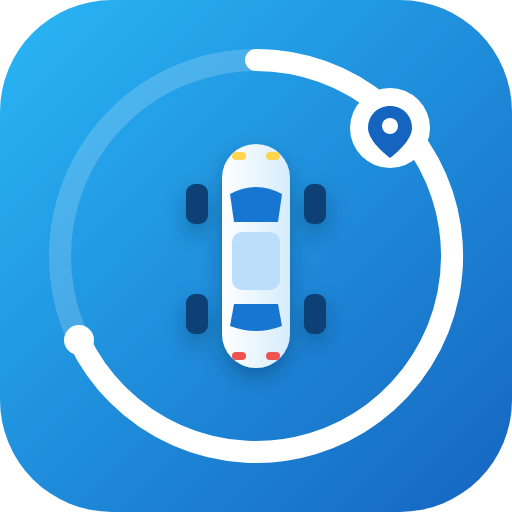

<p align="center"></p>

# Autos Card HA

Carte Home Assistant visuelle pour suivre ses voitures : batterie, carburant, autonomie, portes et ouvertures (illustration vue de dessus), statuts et boutons d'action.

## Installation avec HACS

1. HACS > menu ⋮ > **Dépôts personnalisés**.
2. Ajouter l'URL de ce dépôt, type **Tableau de bord**.
3. Installer **Autos Card HA**, puis recharger la page.

## Ajout en quelques clics (détection automatique)

1. Sur ton tableau de bord : **Modifier** > **Ajouter une carte** > **Autos Card HA**. Si un véhicule est reconnu, la carte se pré-remplit toute seule.
2. Dans l'éditeur visuel, choisis ton véhicule dans la liste **Véhicule détecté**.
3. L'encadré en dessous montre ce qui a été trouvé (position, adresse, batterie, carburant, verrou, charge, moteur, kilométrage, consommations, climatisation, portes, vitres, tuiles, boutons).
4. Ajuste le nom, la photo, la couleur, les blocs affichés et la carte avec les champs de l'éditeur. La section **Entités : remplacer la détection** permet de corriger une entité mal reconnue.

Le YAML produit est minimal :

```yaml
type: custom:autos-card-ha
device: 0123456789abcdef0123456789abcdef
name: Volvo XC60
```

Comment ça marche : la carte lit les appareils et entités de Home Assistant, garde ceux qui ressemblent à une voiture (verrou, portes, batterie, carburant, position), puis rattache chaque entité à son rôle d'après sa classe d'appareil, son unité et son nom (français ou anglais). Les entités que tu indiques toi-même ont toujours priorité sur la détection.

Pour des raisons de sécurité, la détection ne propose jamais de bouton de démarrage du moteur. Le bouton **Déverrouiller** demande une seconde pression pour confirmer.

Le champ `device` est l'identifiant de l'appareil : le plus simple est de le choisir dans l'éditeur.

## Configuration manuelle

Volvo XC60 :

```yaml
type: custom:autos-card-ha
name: Volvo XC60
location: device_tracker.volvo_xc60
battery: sensor.volvo_xc60_batterie
fuel: sensor.volvo_xc60_fuel_amount
fuel_max: 70
range_electric: sensor.volvo_xc60_distance_to_empty_battery
range_fuel: sensor.volvo_xc60_distance_to_empty_tank
lock: lock.volvo_xc60_lock
charging: sensor.volvo_xc60_charging_status
engine: binary_sensor.volvo_xc60_engine_status
odometer: sensor.volvo_xc60_odometer
consumption_fuel: sensor.volvo_xc60_trip_manual_average_fuel_consumption
consumption_electric: sensor.volvo_xc60_trip_manual_average_energy_consumption
address: sensor.volvo_xc60_adresse # capteur d'adresse, si tu en as un
climate_on: button.volvo_xc60_start_climatization
climate_off: button.volvo_xc60_stop_climatization
doors:
  front_left: binary_sensor.volvo_xc60_door_front_left
  front_right: binary_sensor.volvo_xc60_door_front_right
  rear_left: binary_sensor.volvo_xc60_door_rear_left
  rear_right: binary_sensor.volvo_xc60_door_rear_right
  tailgate: binary_sensor.volvo_xc60_tailgate
  hood: binary_sensor.volvo_xc60_hood
windows:
  - entity: binary_sensor.volvo_xc60_window_front_left
    name: Vitre avant gauche
  - entity: binary_sensor.volvo_xc60_window_front_right
    name: Vitre avant droite
  - entity: binary_sensor.volvo_xc60_window_rear_left
    name: Vitre arrière gauche
  - entity: binary_sensor.volvo_xc60_window_rear_right
    name: Vitre arrière droite
  - entity: binary_sensor.volvo_xc60_sunroof
    name: Toit ouvrant
stats:
  - entity: sensor.volvo_xc60_trip_manual_distance
    name: Trajet manuel
    icon: mdi:map-marker-distance
  - entity: sensor.volvo_xc60_time_to_service
    name: Entretien dans
    icon: mdi:wrench-clock
  - entity: sensor.volvo_xc60_distance_to_service
    name: Entretien dans (km)
    icon: mdi:wrench
actions:
  - climate: true
  - entity: button.volvo_xc60_honk_flash
    name: Klaxon et feux
    icon: mdi:bullhorn
```

Peugeot (électrique) :

```yaml
type: custom:autos-card-ha
name: Peugeot
location: device_tracker.vr3uhzkxznt055916_vehicule
battery: sensor.vr3uhzkxznt055916_niveau_batterie
range_electric: sensor.vr3uhzkxznt055916_autonomie_batterie
odometer: sensor.vr3uhzkxznt055916_kilometrage
climate_on: button.vr3uhzkxznt055916_demarrer_pre_conditionnement
climate_off: button.vr3uhzkxznt055916_arreter_pre_conditionnement
climate_state: binary_sensor.vr3uhzkxznt055916_pre_conditionnement
doors:
  front_left: binary_sensor.vr3uhzkxznt055916_porte_conducteur
  front_right: binary_sensor.vr3uhzkxznt055916_porte_passager
  rear_left: binary_sensor.vr3uhzkxznt055916_porte_arriere_gauche
  rear_right: binary_sensor.vr3uhzkxznt055916_porte_arriere_droite
  tailgate: binary_sensor.vr3uhzkxznt055916_coffre
stats:
  - entity: sensor.vr3uhzkxznt055916_soh_batterie
    name: Santé batterie
    icon: mdi:battery-heart-variant
  - entity: sensor.vr3uhzkxznt055916_dernier_trajet
    name: Dernier trajet
    icon: mdi:map-marker-distance
  - entity: sensor.vr3uhzkxznt055916_jours_avant_entretien
    name: Entretien dans (jours)
    icon: mdi:wrench-clock
actions:
  - entity: button.vr3uhzkxznt055916_verrouiller_portes
    name: Verrouiller
    icon: mdi:lock
  - entity: button.vr3uhzkxznt055916_deverrouiller_portes
    name: Déverrouiller
    icon: mdi:lock-open
  - climate: true
  - entity: button.vr3uhzkxznt055916_demarrer_recharge
    name: Démarrer charge
    icon: mdi:battery-charging
```

## Plusieurs véhicules dans la même carte

Une seule carte peut afficher plusieurs véhicules, avec un sélecteur en haut (un onglet par véhicule). Chaque onglet a son illustration, ses barres, ses statuts, son plan, son adresse et ses boutons. Le dernier véhicule choisi est mémorisé dans le navigateur.

Dans l'éditeur, le champ **Plusieurs véhicules dans la même carte (onglets)** permet de les choisir. Le champ **Régler le véhicule** apparaît alors : il choisit l'onglet dont tu modifies le nom, la photo, la couleur et les entités. Le plan, les blocs affichés et le style sont communs. En YAML :

```yaml
type: custom:autos-card-ha
vehicles:
  - device: 0123456789abcdef0123456789abcdef
    name: Volvo XC60
  - device: fedcba9876543210fedcba9876543210
    name: Peugeot e-208
    image: /local/peugeot.png
```

Chaque entrée accepte les mêmes options qu'une carte seule (`name`, `image`, `body_color`, `location`, `actions`...). Les options placées à côté de `vehicles` (par exemple `map_theme`) s'appliquent à tous les onglets. Une simple liste d'identifiants fonctionne aussi, et `vehicles: auto` crée un onglet par véhicule détecté.

## Graphiques d'historique

Un clic sur une barre (batterie, carburant, autonomies), un statut (verrou, charge, moteur, portes, vitres), une tuile d'info ou la position ouvre la fenêtre de détails de Home Assistant, avec le graphique d'historique de l'entité. Rien à configurer.

## Bouton de climatisation unique

Un seul bouton remplace « Activer » et « Couper » : il affiche **Activer la clim** quand elle est éteinte et **Couper la clim** quand elle tourne, avec une pastille « Clim en marche ».

- `climate_on` et `climate_off` sont les deux boutons de la voiture (détectés automatiquement).
- `climate_state` est une entité qui dit si la clim tourne (`binary_sensor`, `switch` ou `climate`). Si elle existe, le bouton suit l'état réel.
- Sans `climate_state` (c'est le cas de la Volvo), Home Assistant ne sait pas si la clim tourne. La carte se souvient alors du dernier appui, depuis ce navigateur, pendant `climate_timeout` minutes (15 par défaut), puis revient à « Activer la clim ». Une clim lancée depuis l'application du constructeur n'est pas vue.
- Pour placer le bouton toi-même dans une liste `actions`, ajoute `- climate: true`.

## Plan et adresse

Le plan a des coins arrondis, l'adresse dans une pastille translucide et un bouton rond **Itinéraire** (ouvre Google Maps vers la voiture).

La mini-carte est un plan clair avec l'adresse en bas à gauche.

- `map_theme` : `light` (par défaut), `dark` ou `auto` (suit le thème de Home Assistant).
- `address` : capteur dont l'état est l'adresse, par exemple `Rue de la Délivrance 35, 68440 Habsheim`. Il est détecté automatiquement s'il existe sur l'appareil. La première partie s'affiche en gros, la suite en dessous en capitales, sans le code postal.
- `map_label` : texte du marqueur. `icon` (par défaut) affiche l'icône de l'entité au lieu des initiales « VXE » ; `name` remet le nom. Pour choisir l'icône, change-la dans Home Assistant (Paramètres > Appareils et services > Entités > ton `device_tracker` > Icône, par exemple `mdi:car-side`).
- `show_address: false` masque l'adresse.
- `map_all_vehicles` (activé par défaut) : le plan affiche aussi la position des autres véhicules détectés dans Home Assistant, et se cadre pour tous les montrer. `false` pour n'afficher que la voiture de la carte. Dès qu'il y a plusieurs marqueurs, ils portent le nom de l'entité (`map_label: icon` pour garder les icônes).
- `map_extra` : liste de `device_tracker` à ajouter au plan (par exemple `- device_tracker.mon_velo`).
- `map_label` : texte du marqueur sur le plan. `icon` (par défaut) affiche l'icône de l'entité au lieu des initiales (« VXE »), `name` remet le nom. Pour une icône de voiture, change l'icône du `device_tracker` dans Paramètres > Appareils et services > Entités > ⚙ > Icône : `mdi:car`. Nécessite une version récente de Home Assistant.
- `geocode: true` (désactivé par défaut) cherche l'adresse sur OpenStreetMap quand il n'y a aucun capteur d'adresse. Le navigateur envoie alors la position de la voiture, arrondie à environ 10 m, à `nominatim.openstreetmap.org`. La réponse est mise en cache dans le navigateur.

## Visuel de ta vraie voiture

Sans réglage, la carte dessine une voiture générique vue de dessus : les portes pivotent sur leurs charnières, le capot et le hayon s'ouvrent, et la couleur se change avec `body_color`.

Dans l'éditeur visuel, les champs **Photo de la voiture** et **Photos avec une ouverture** ouvrent le navigateur de médias de Home Assistant : tu choisis directement une image déjà stockée (dossier `media`, ou image téléversée depuis le sélecteur). La carte enregistre un identifiant `media-source://...` qu'elle convertit elle-même en adresse temporaire à chaque affichage.

Tu peux aussi, en YAML, utiliser des fichiers de `/config/www/` (servis sous `/local/`) :

```yaml
type: custom:autos-card-ha
device: 0123456789abcdef0123456789abcdef
image: /local/volvo/fermee.png
open_images:
  front_left: /local/volvo/porte_avant_gauche.png
  front_right: /local/volvo/porte_avant_droite.png
  rear_left: /local/volvo/porte_arriere_gauche.png
  rear_right: /local/volvo/porte_arriere_droite.png
  tailgate: /local/volvo/coffre.png
  hood: /local/volvo/capot.png
```

- `image` est la voiture fermée. Chaque entrée de `open_images` est la même vue de la voiture avec la porte (ou le coffre, ou le capot) ouverte. Toutes les images doivent avoir les mêmes dimensions.
- L'image correspondante apparaît en fondu quand l'ouverture est détectée. Si plusieurs ouvertures sont actives, la dernière de la liste s'affiche par-dessus.
- Avec ces images, la vue de dessus est masquée. `show_top_view: true` la remet.
- Les clés disponibles sont `front_left`, `front_right`, `rear_left`, `rear_right`, `tailgate` et `hood`. Tu peux n'en renseigner que quelques-unes.

## Options

| Option | Rôle |
| --- | --- |
| `name` | Titre de la carte |
| `location` | `device_tracker` pour afficher « À la maison » |
| `battery`, `fuel`, `fuel_max` | Barres de batterie (en %) et de carburant. `fuel_max` est la capacité du réservoir en litres (70 par défaut, 100 si le capteur est en %) |
| `range_electric`, `range_fuel` | Autonomies affichées à côté des barres |
| `lock`, `charging`, `engine` | Pastilles de statut |
| `doors` | `front_left`, `front_right`, `rear_left`, `rear_right`, `tailgate`, `hood` : l'ouverture s'anime sur l'illustration |
| `windows` | Liste d'entités ouvertes à signaler |
| `stats` | Tuiles d'information (`entity`, `name`, `icon`) |
| `actions` | Boutons (`button.*` presse, `lock.*` verrouille ou déverrouille, autres entités basculent) |
| `image` | Photo de la voiture (par exemple `/local/volvo.png`, fichier placé dans `/config/www/`). Remplace l'illustration du bandeau |
| `body_color` | Couleur de la carrosserie de l'illustration (par exemple `#1e88e5`) |
| `map` | `false` pour masquer la mini-carte (affichée par défaut dès que `location` fournit une position) |
| `map_zoom` | Niveau de zoom de la mini-carte (15 par défaut) |
| `vehicles` | Plusieurs véhicules dans la même carte, voir plus haut |
| `device` | Appareil du véhicule : active la détection automatique de toutes les entités |
| `show_banner`, `show_chips`, `show_stats`, `show_actions` | `false` pour masquer l'illustration, les statuts, les tuiles ou les boutons |
| `odometer` | Capteur de kilométrage, affiché en première tuile |
| `consumption_fuel`, `consumption_electric` | Capteurs de consommation essence et électrique, affichés en tuiles |
| `climate_on`, `climate_off`, `climate_state`, `climate_timeout` | Bouton de clim unique, voir plus haut |
| `address`, `show_address`, `geocode`, `map_theme` | Adresse et style du plan, voir plus haut |
| `actions[].confirm` | `true` pour exiger une seconde pression avant d'exécuter le bouton |
| `open_images` | Images de ta voiture avec une ouverture active, par clé (`front_left`, `tailgate`, `hood`...). Nécessite `image` |
| `show_top_view` | `true` ou `false` pour afficher la vue de dessus (masquée par défaut quand `open_images` est utilisé) |

Tous les champs sont facultatifs : ce qui n'est pas configuré ni détecté n'est pas affiché.
